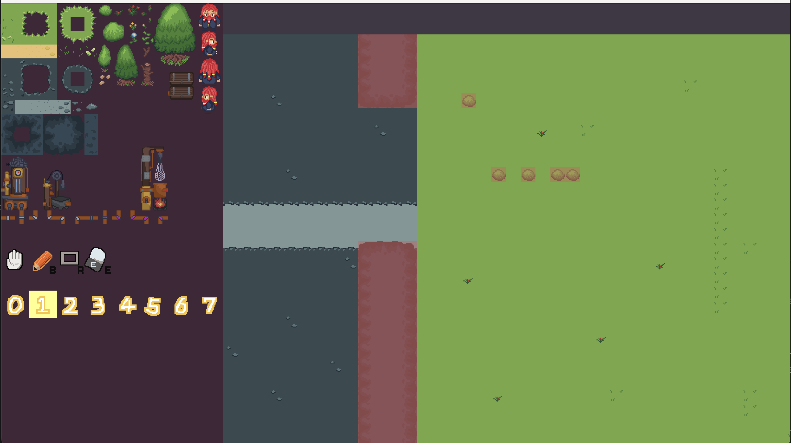

# Dinosaur-Potion-Factory


- src/main/: main.cpp, PlayMode.cpp, and core code
- src/starter/: everything in the starter code, other than main and PlayMode
- src/rendering/: TextRenderer and Sprites


## Map Editor

Launching the map editor:
```bash
# Must specify map filepath
./dist/editor maps/demo.map
```

If you want to create a new, blank map:
```bash
# Note: once created, width, height and num_layers can NO LONGER be changed! Didn't work on a resizing function.
# Also, num layer must be 8, as a convention.
#                                 W   H  L
python ./assets/make_empty_map.py 120 80 8
```



Inside the editor, you can see a panel on the left, and the tilemap on the right.

- Tileset palette: the palette of tiles you can use.
- Tool indicator: there are four indicators, DRAG, PEN, RECT, and ERASE. More on them later.
- Layer indicator: shows which layers are visible, and which layer is selected right now.

Controls for the editor (many options only have keyboard shortcut, no clickable buttons, sorry):
- **click or drag on Palette** to select which tiles to use.
- **hold `[space]` and drag** to move around.
- **press `[` and `]`** to switch selected layer.
- **press `+` and `-`** to zoom in and out.
- **press `0–7`** to show/hide a layer.

- **press `E`** to disable/enable ERASE.
- **press `R`** to enter RECT mode. (`U` also works, that's Aseprite shortcut)
- **press `B`** to enter PEN mode. (That's the shortcut in Aseprite and Photoshop)

- **drag on Map** to draw: RECT draws rectangle. PEN draws free lines.

- **press `Z`** to undo. There is only about 20 or so steps stored at most! No infinite undo!
- **press `S`** to save. It WILL overwrite existing map, so remember to git stage/commit frequently!!!!!!

Special notes:
- **Layer 0 is reserved for physics.** Drawing on it only shows the collision areas (in red shades).
- If you drew something but saw nothing, maybe it is because another layer above it is covering it?
- You can technically draw tiles out of the tileset range. It will be buggy but why not
- If you are enlarging tileset sheet, please modify EditorMode.cpp:22-23.