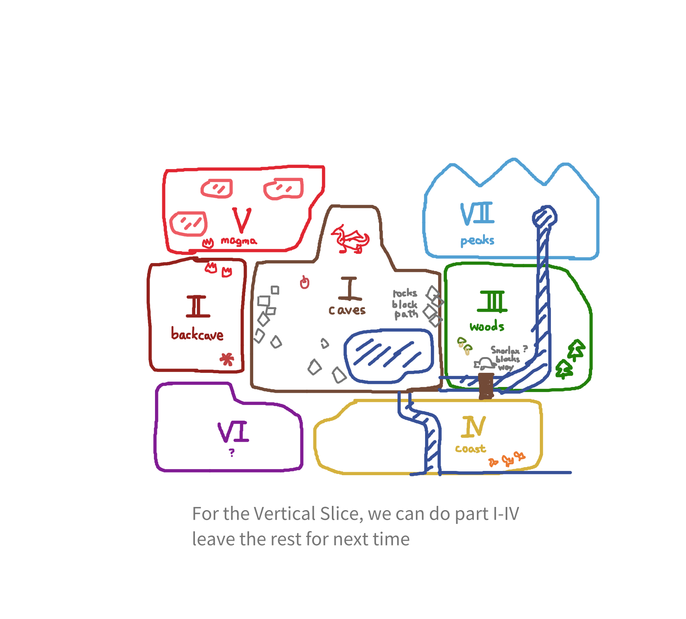

# game design

Kind of stuff
- Places
- Resources
- Recipes
- Products
- Machines

# Layer convention
0=DATA
1=GROUND
2=GROUND OVERLAY
3=WALL
4=WALL OVERLAY
5=DECOR?
6=???
7=???

### Game progression

#### (1) Cave I

The dwarf was tending a Dragon that was super ill.

Due to a collapse caused by the Dragon's health conditions (sneezing), the dwarf was stuck in the cave.
Brew **Ale/Cider** with **Cave Apples** to push the boulders blocking the path.

#### (2) Cave II

The dwarf found his missing pickaxe and some other stuff. He can now mine ores and move machines. 
The dragon can smith machines for the dwarf (Crusher, Brewer, Baker, Pipes, Chests).
The dragon asks for 5 bottles of **Strength Potion** (better than Ale). It is brewed from apple + lichen.

- I think the dragon's shedded fins are like crystal/glass in cone shapes; and they somehow work as bottles in the game.

#### (3) Forest

With the strength potion, you could break the rocks blocking the path to outside.
The dragon recovered more strength from the potion. It can smith more machines now.

Outside the cave is the forest. You could only explore a restricted section (surrounded by trees and cliffs and rivers...)

A bridge to the south was either broken or blocked, which requires constructing something or some potion. (TBD)

#### (4) Coast

By the coast you can do some more stuff. 

### Recipes

Each section introduces one new raw material.

[CAVE]        Apple
[CAVE2]       Red Lichen   
[FOREST]      Shroom (Good shroom and Weird shroom)
[BEACH]       Coral
[VOLCANO]     Lava fruit
[PURPLECAVE]  Quartz
[PEAK]        Exilir's ingredient

Each ingredient has the matching "processed" items, such as baked, powder, baked powder.
Some ingredients have special forms, like fermented, etc.
Some undefined recipes result in craps (useless items).

Processes:
- Crushing: Raw --> Powder (and Juice)
- Baking: Raw ---> Baked;    Powder ---> Baked Powder (or trash items)
  - Heated crushing
- Mixing: Powder A + Powder B ---> Mixed powder (or trash items)
- Distilling: Potion ---->  Powder + Distilled Liquid (usually water)

Processes involving water/potions:
- Brewing: base potion (water) + ingredient ----> new potion
- Filtering: liquid --> clean liquid + sediments
- Fermenting: ingredient A + potion A ---> ingredient B + potion B
- Cooling: base potion -----> clean liquid + sediments

#### Cave I

EmptyBottle * 1                      ----LAKE------->     WaterBottle
Apple       * 1                      ----CRUSHER---->     ApplePowder
WaterBottle * 1 + ApplePowder * 3    ----BREWER----->     Cider

#### Cave II

Apple       * 1                      ----BAKER------>     BakedApple
BakedApple  * 1                      ----CRUSHER---->     ApplePaste
ApplePowder * 1                      ----BAKER------>     Ash
Lichen      * 1                      ----CRUSHER---->     LichenPowder
Lichen      * 1                      ----BAKER------>     BakedLichen
LichenPowdr * 1                      ----BAKER------>     RedPowder            # This recipe takes less time than the other one
BakedLichen * 1                      ----CRUSHER---->     RedPowder

WaterBottle * 1 + LichenPowder* 4    ----BREWER----->     Lichen Ale           # No effects
WaterBottle * 1 + RedPowder   * 4    ----BREWER----->     RedPotion
RedPotion   * 1 + ApplePowder * 3    ----BREWER----->     StrengthPotion 

### Resources / Products
[CAVE]   --- Tutorial
- Cave Apple...     magically grown in the cave for some reason.
- Water...        cave water.
- Empty Bottle...

Products
- Water Bottle
- Apple Powder
- Cider

[CAVE2]  --- After Ale
- Copper Ore...     dragon uses it to manufacture machines.
- Red Lichen...     something magical
- Rock...           tiny rocks appearing everywhere.

Product
- Baked Apple, Apple Paste, Ash
- Baked Lichen, Raw Lichen Powder, Red Powder
- Red Potion, Strength Potion

[FOREST] --- Use STRENGTH POTION to break remaining blockers
- Wood              dropped in the forest. Use to build machines
- Nice Shroom       used in recipe    
- Weird Shroom      used in recipe (bad material)
- 

[BEACH]  ---  Use some ENERGY POTION to wake up a Snorlax blocking the path?
- Shiny Coral       used in recipe, mined

[VOLCANO] --- Use FIRE PROTECTION POTION to enter safely
- new ore           used to build machines
- Lava fruit        used in recipe

[PURPLECAVE]  --- Use something made from Lava fruit to unlock
- quartz?     used in recipe

[PEAK]    --- Use some potion made from crystals? to unlock
- ingredient to elixir of life. final missing piece

#### Machines
[CAVE]
- Crusher...      grind raw resource.
  - SOLID ---> SOLID
- Brewer...       combine potion base (e.g. water), and ingredient (e.g. apple)
  - SOLID + LIQUID ---> LIQUID

[CAVE2]
- Baker...        bake something
  - SOLID ---> SOLID

[FOREST]
- Filter...
  - LIQUID ---> SOLID + LIQUID
- Mixer...        mix solid ingredients
  - POWDER + POWDER ----> POWDER
- CrusherPlus..
  - FRUIT + Bottle ----> SOLID + LIQUID
- Boiler...
  - 

- Heat Pestler
- Distiller
  - LIQUID ----> LIQUID + SOLID

- Cooler
- Mixer

- Harvester...    autocollect replenishing resources
  - collect crops

### Crafting

Mixer = 15 ore + 5 glass?
Chest = 5 ore + 5 wood?
Brewer = 20 ore + 10 glass?
Pipe = 2 ore?
Baker = 10 ore + 15 rock

